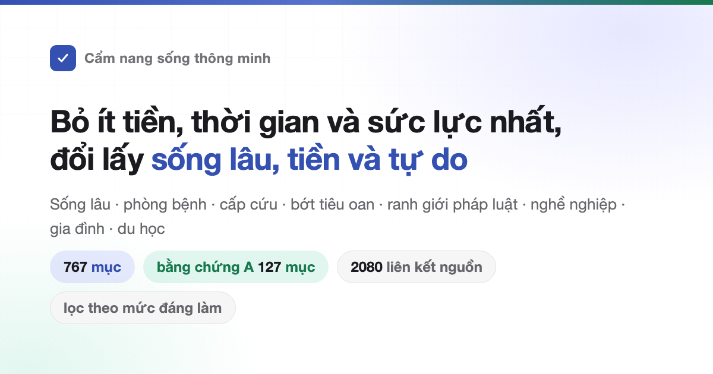

<div align="center">



# Cẩm nang sống thông minh

Cuốn sách tính chuyện đáng hay không đáng làm theo hiệu quả trên chi phí: sống lâu, ít bệnh, gặp tai nạn thì cứu thế nào; tiêu tiền sao cho khỏi oan; việc gì dễ bị lừa, dễ vướng vào pháp luật; mất việc, hết tiền thì nhận được gì; mở shop, mở công ty, làm website phải xin những giấy gì; cả chuyện yêu đương, kết hôn, sinh con, du học và học nghề.<br>
767 mục, mỗi mục ghi rõ mất gì, được gì và bằng chứng cứng đến đâu. Nguồn chỉ dẫn bài báo khoa học và văn bản chính thức.

Không cần làm hết: đây là danh sách để chọn, không phải danh sách phải hoàn thành.

Đây là **bản biên soạn lại cho Việt Nam**, không phải bản dịch. Luật, chính sách, thủ tục, giá cả và mức phạt đều tra từ văn bản chính thức của Việt Nam; nội dung y khoa dùng nghiên cứu quốc tế. Vì luật khác nhau, có mục kết luận ngược hẳn bản gốc. Bản gốc tiếng Trung vẫn giữ trong repo để đối chiếu: [README.cn.md](README.cn.md).

[](https://quangpao.github.io/HowToLiveBetter/)
[](#mục-lục)
[](#mức-bằng-chứng)
[](docs/kiem-chung/)
[](#ghi-công-và-giấy-phép)
[](https://github.com/quangpao/HowToLiveBetter)

### [Mở trang tra cứu](https://quangpao.github.io/HowToLiveBetter/) · [Đọc bản gốc tiếng Trung](README.cn.md)

<table>
<tr><td align="right"><b>Tải về</b></td><td align="left">

[PDF](https://github.com/quangpao/HowToLiveBetter/releases/download/epub-latest/HowToLiveBetter.pdf) · [EPUB](https://github.com/quangpao/HowToLiveBetter/releases/download/epub-latest/HowToLiveBetter.epub) · [HTML một file, mở là đọc](https://github.com/quangpao/HowToLiveBetter/releases/download/epub-latest/HowToLiveBetter.html) · [Bộ thẻ Anki](https://github.com/quangpao/HowToLiveBetter/releases/download/epub-latest/HowToLiveBetter.apkg)

</td></tr>
<tr><td align="right"><b>Tra cứu</b></td><td align="left">

[Mục lục](#mục-lục) · [Thuật ngữ](#đọc-con-số) · [Sổ kiểm chứng](docs/kiem-chung/)

</td></tr>
<tr><td align="right"><b>Tự kiểm</b></td><td align="left">

[Việc nào mình đã làm rồi](https://quangpao.github.io/HowToLiveBetter/selfcheck.html): trả lời vài chục câu có/không, xem còn thiếu việc nào và nên làm việc nào trước

</td></tr>
<tr><td align="right"><b>Bài dài</b></td><td align="left">

Chưa có. Bài dài sẽ nằm trong `docs/` khi từng chương xong.

</td></tr>
<tr><td align="right"><b>Bản gốc</b></td><td align="left">

[高性价比人生指南](README.cn.md) của [eternity4719](https://github.com/eternity4719/HowToLiveBetter), 767 mục trong 34 chương, giấy phép CC BY 4.0. Bản tiếng Việt phát hành theo cùng giấy phép.

</td></tr>
</table>

<sub>Bản tiếng Việt là bản biên soạn lại, có thể đã lạc hậu so với bản gốc. Đối chiếu luật và giá hiện hành trước khi dùng để làm việc thật.</sub>

</div>

---

## Cuốn sách này trả lời câu gì

| Câu hỏi | Xem ở đâu |
| --- | --- |
| Việc gần như không tốn tiền mà giảm rõ rệt nguy cơ chết sớm là những việc nào? | [1. Đừng chết sớm](book/01-dung-chet-som.md) |
| Hút thuốc, uống rượu, ngồi nhiều, thức khuya rút ngắn đời bao nhiêu; cai thuốc cai rượu làm thế nào; chọn và dùng dầu ăn ra sao? | [2. Đừng chết dần](book/02-dung-chet-dan.md) |
| Ngày nào cũng hết sức, lúc nào cũng bị ngắt ngang, sửa thế nào? | [3. Đừng lãng phí sức lực](book/03-dung-lang-phi-suc-luc.md) |
| Việc gì cũng dồn tới hạn mới làm, họp thì dài mà chẳng xong việc, sửa thế nào? | [4. Đừng lãng phí thời gian](book/04-dung-lang-phi-thoi-gian.md) |
| Tiền tiết kiệm để đâu cho khỏi bị lãi suất, phí và trò lừa ăn mất; mua xe sao cho khỏi bị hớ? | [5. Đừng lãng phí tiền](book/05-dung-lang-phi-tien.md) |
| Thực phẩm bổ sung, gói khám sức khoẻ, đồ "đáng tiền" nào bỏ qua được? | [6. Danh sách những thứ trông rẻ mà không có tác dụng](book/06-nhung-thu-vo-dung.md) |
| Mất việc, bị quỵt lương, trong túi không còn tiền thì nhận được gì, cầu cứu ở đâu? | [7. Không có tiền thì sống thế nào](book/07-khong-co-tien-thi-song-the-nao.md) |
| Tiền cọc, nhà trước hôn nhân, chuyển khoản lớn khi đang yêu là của ai; bị tố giác hay bị vu khống thì làm gì trước? | [8. Đừng tự chuốc hoạ vào thân: pháp luật và tài sản](book/08-dung-tu-chuoc-hoa-vao-than.md) |
| Việc làm thêm nào, việc tưởng vô hại nào biến người thường thành bị cáo? | [9. Ranh giới pháp luật người thường dễ vấp](book/09-ranh-gioi-phap-luat-nguoi-thuong-de-vap.md) |
| Nên theo đuổi một người hay quen nhiều người; yêu xa có thành không; đăng ký kết hôn cần gì; chỉ làm đám cưới mà không đăng ký thì có phải vợ chồng? | [10. Yêu và kết hôn có đáng không](book/10-yeu-va-ket-hon-co-dang-khong.md) |
| Viết code nào, nhận việc nào thì bị truy tố? | [11. Những vạch đỏ mà người làm kỹ thuật hay vấp](book/11-nhung-vach-do-nguoi-lam-ky-thuat-hay-vap.md) |
| Vay tiền mở shop, mở công ty: nghĩ gì trước tiên, đóng cửa thì mất gì? | [12. Kinh doanh nhỏ: mở, vận hành, đóng cho đúng luật](book/12-kinh-doanh-nho-mo-van-hanh-dong.md) |
| Có người ngã xuống không thở, chảy máu nhiều, cháy, lạc đường: làm gì trước? | [13. Cấp cứu: những phút quyết định](book/13-cap-cuu-nhung-phut-quyet-dinh.md) |
| Mất tài khoản, mất điện thoại: làm gì trước? | [14. Những tài khoản và dữ liệu của bạn](book/14-nhung-tai-khoan-va-du-lieu-cua-ban.md) |
| Bị giữ tiền cọc, bị đuổi nhà, chung cư trả trước phá sản; tiền mua nhà hình thành trong tương lai nộp vào đâu? | [15. Thuê và mua nhà](book/15-thue-va-mua-nha.md) |
| Đã mắc bệnh mạn tính: quản lý lâu dài thế nào, đỡ tốn tiền ra sao? | [16. Bệnh mạn tính: sống tiếp thế nào](book/16-benh-man-tinh-song-tiep-the-nao.md) |
| Giám hộ, di chúc và tiền của người già nên xếp trước thế nào? | [17. Trong nhà có người cao tuổi](book/17-trong-nha-co-nguoi-cao-tuoi.md) |
| Sinh con được nhận gì, tốn bao nhiêu thời gian và tiền? | [18. Nuôi con: tiền bạc và thời gian](book/18-nuoi-con-tien-bac-va-thoi-gian.md) |
| Lương làm thêm giờ, phép năm tính thế nào; bị cho nghỉ thì được đền bao nhiêu; tai nạn lao động khai và nhận tiền ra sao? | [19. Đang làm, nghỉ việc, và tai nạn lao động](book/19-dang-lam-nghi-viec-va-tai-nan-lao-dong.md) |
| Trẻ sơ sinh: việc gì phải đúng ngay? | [20. Chăm trẻ sơ sinh](book/20-cham-tre-so-sinh.md) |
| Nước nào đang không nên đi; ở ngoài thì đại sứ quán giúp được tới đâu? | [21. Ra nước ngoài](book/21-ra-nuoc-ngoai.md) |
| Đi karaoke, quán net, phòng giải đố sao cho khỏi vạ; căng thẳng thì làm gì hiệu quả nhất? | [22. Nghỉ ngơi và giải trí](book/22-nghi-ngoi-va-giai-tri.md) |
| Học nghề gì thì hoàn vốn, học sao cho đỡ tốn thời gian, có nên học tiếp lên? | 23. Học gì thì đáng — đang biên soạn |
| Cùng một bệnh, khám tuyến xã và bệnh viện tỉnh chênh bao nhiêu; trả tiền ra sao, giấy tờ gì cần giữ? | 24. Đi khám: tốn ít tiền, ít vòng vo — đang biên soạn |
| Trong nhà có người mất: làm gì trước, lấy lại được khoản nào, khoản nào không phải trả? | 25. Khi có người mất — đang biên soạn |
| Làm website hay nền tảng thu tiền thì phải xin giấy gì, đặt máy chủ ở đâu? | 26. Làm website hay nền tảng — đang biên soạn |
| Có thai, sắp sinh: khi nào làm gì, trước khi ra viện phải làm giấy gì? | 27. Mang thai và sinh nở — đang biên soạn |
| Muốn giảm cân, muốn đẹp hơn, muốn niềng răng: cách nào làm hỏng người? | 28. Đừng vì ngoại hình mà phá sức khoẻ — đang biên soạn |
| Người thân mất, bị cho nghỉ việc, nhận chẩn đoán nặng: mấy tháng đầu phải lo gì? | 29. Sau một cú đánh lớn — đang biên soạn |
| Con đi học rồi: việc gì về thân thể và tâm lý không chờ được đến sau kỳ thi? | 30. Trẻ đi học — đang biên soạn |
| Sau 18 tuổi, ngoài học đại học và đi làm còn đường nào, mỗi đường cần gì? | 31. Sau 18 tuổi có những con đường nào — đang biên soạn |
| Du học: thân phận, việc làm thêm, bảo hiểm và công nhận bằng khi về nước? | 32. Du học — đang biên soạn |
| Bản thân hay người nhà bị khuyết tật: phòng biến chứng gì, nhận trợ cấp nào, học hành và giám hộ ra sao? | 33. Khi bị khuyết tật — đang biên soạn |
| Thuốc cảm, thuốc hạ sốt, thuốc dạ dày mua về tự uống: loại nào không được uống chung, trẻ con và bà bầu phải tránh gì? | 34. Tủ thuốc trong nhà — đang biên soạn |

## Cách đọc

- **Không cần làm hết**: đây là danh sách để chọn, không phải danh sách phải hoàn thành. Chọn một hai mục cũng đã có ích, còn lại để đó, cần thì quay lại tra.
- **Muốn lọc theo điều kiện**: mở [trang tra cứu](https://quangpao.github.io/HowToLiveBetter/), lọc được theo từ khoá, theo chương, theo mức bằng chứng, và theo ba thứ phải bỏ ra — tiền, thời gian, ý chí. Các điều kiện chồng lên nhau được. Nội dung trang lấy thẳng từ `book/`, sửa một mục là trang đổi theo.
- **Muốn biết trước tiên nên làm gì**: lọc mức đáng làm "rất cao" — những mục không tốn tiền, không tốn thời gian, không cần ý chí mà lợi ích lại lớn nhất.
- **Chỗ nào là nội dung riêng của Việt Nam**: trên trang tra cứu, hai chữ **Việt Nam** được tô nền nhạt. Đó là những chỗ luật, mức phạt, giá và số liệu đã tra theo văn bản Việt Nam — đọc kỹ những chỗ này, vì phần còn lại thường là bằng chứng y khoa quốc tế dùng chung.
- **Muốn đọc trên máy không có mạng, hoặc gửi cho người khác**: tải [HTML một file](https://github.com/quangpao/HowToLiveBetter/releases/download/epub-latest/HowToLiveBetter.html). Cả cuốn sách kèm phần lọc nằm trong một file, bấm đúp là mở, không cần máy chủ, không cần mạng, gửi qua Zalo cũng được.
- **Muốn in hoặc đọc trên điện thoại**: tải [PDF](https://github.com/quangpao/HowToLiveBetter/releases/download/epub-latest/HowToLiveBetter.pdf). Khổ A4, có mục lục kèm số trang và bookmark, mỗi chương sang trang mới.
- **Muốn đọc trên máy đọc sách**: tải [EPUB](https://github.com/quangpao/HowToLiveBetter/releases/download/epub-latest/HowToLiveBetter.epub), Kindle thì gửi qua Send to Kindle.
- **Muốn nhớ lâu**: tải [bộ thẻ Anki](https://github.com/quangpao/HowToLiveBetter/releases/download/epub-latest/HowToLiveBetter.apkg), mở bằng Anki là nhập được. Mỗi mục một thẻ, chia thẻ con theo chương. Mặt trước là việc nên làm, mặt sau là "nói dễ hiểu", chi phí và mức bằng chứng. Tải lại rồi nhập lần nữa thì nội dung thẻ được cập nhật, lịch sử ôn không mất.
- **Bốn định dạng này tự dựng lại mỗi lần nội dung đổi**, đường dẫn tải không đổi; bản đã gửi đi thì không tự cập nhật, lấy bản trên mạng làm chuẩn.
- **Không hiểu con số trong mục**: mỗi mục có một dòng "Nói dễ hiểu", dịch các con số trong cột "Lợi ích" thành câu thường. Chỉ đọc dòng đó cũng đủ quyết định. Con số gốc vẫn nằm nguyên trong cột "Lợi ích" cho ai muốn tự tra.
- **Tiêu đề chương bắt đầu bằng "Đừng…" không có nghĩa mục nào cũng là lời cấm**: tiêu đề chương nói chương này muốn chặn cái gì (đừng chết sớm, đừng lãng phí thời gian). Việc cụ thể nằm ở tiêu đề từng mục, luôn bắt đầu bằng động từ, tự nó nói rõ là nên làm gì hay đừng làm gì.

Mỗi mục trông như thế này:

```markdown
### 9. Đổi sang muối giảm natri — nhưng người bệnh thận phải hỏi bác sĩ trước
<!-- nhãn: tiền=ít thời-gian=ít ý-chí=có lợi-ích=lớn thước-đo=tử-vong -->
- Chi phí: Đắt hơn muối thường chút ít, chênh lệch tính bằng nghìn đồng một gói — không đáng kể so với tiền thuốc huyết áp.
- Nói dễ hiểu: Với người đã bị tăng huyết áp hoặc từng đột quỵ, đổi muối thường sang muối giảm natri (có kali) làm đột quỵ giảm 14% và tử vong giảm 12%.
- Lợi ích: Thử nghiệm SSaSS của Neal (NEJM 2021) làm ở 600 làng của Trung Quốc với 20.995 người, theo dõi trung bình 4,74 năm: đột quỵ giảm 14% (RR 0,86; 95% CI 0,77–0,96), tử vong giảm 12% (RR 0,88; 0,82–0,95).
- Mức bằng chứng: A
- Nguồn: Neal B và cs. (2021). Effect of Salt Substitution on Cardiovascular Events and Death. New England Journal of Medicine 385(12):1067–1077. https://doi.org/10.1056/NEJMoa2105675
- Ghi chú: **Đừng dùng muối giảm natri nếu bạn có bệnh thận mạn, đang dùng thuốc giữ kali, hoặc đang bổ sung kali** — thử nghiệm SSaSS loại trừ những người này.
```

## Bốn nguồn lực

Cuốn sách không chỉ tính chuyện sống lâu. Có bốn thứ cần giữ:

- **Mạng sống**: sống lâu hơn, bớt chết vì những thứ tránh được.
- **Thời gian và sức lực**: thời gian sống không tiêu vào việc không thu lại gì, sự tập trung mỗi ngày không bị rút cạn.
- **Tiền**: bớt tiêu oan, đặt tiền vào chỗ lợi ích rõ ràng.
- **Tự do thân thể**: không vì không biết một ranh giới mà tự đưa mình vào đồn hay vào trại tạm giam.

Mỗi mục trả lời hai câu: mất gì (tiền, thời gian, ý chí), được gì (tử vong chung giảm bao nhiêu, tử vong do một nguyên nhân giảm bao nhiêu, tiết kiệm được bao nhiêu thời gian và sức, tiết kiệm được bao nhiêu tiền, được bảo đảm và tự do đến đâu). Mức đáng làm của từng mục do trang tra cứu tính từ lợi ích và ba loại chi phí, không phải một con số cho sẵn.

Con số tử vong, con số thời gian và sức lực, con số tiền và hậu quả pháp lý tính riêng, không đổi qua nhau. Bốn thứ này ứng với bốn mục "đổi lấy cái gì" trên trang tra cứu, giữa chúng không so lớn nhỏ.

## Mức bằng chứng

| Mức | Nghĩa |
| --- | --- |
| A | Có thử nghiệm chia nhóm ngẫu nhiên, hoặc tổng quan hệ thống gộp nhiều nghiên cứu, hoặc phân loại của cơ quan quốc tế khi chính phân loại đó là nội dung của mục |
| B | Nhiều nghiên cứu theo dõi, phân tích gộp lớn, kết quả nhất quán và có liều–đáp ứng, nhưng vẫn là nghiên cứu quan sát nên không chứng minh được nhân quả |
| C | Chỉ có một nghiên cứu theo dõi duy nhất, hoặc nhiễu nặng, hoặc các nghiên cứu mâu thuẫn nhau, hoặc chỉ có khuyến cáo chuyên môn và kinh nghiệm |

767 mục hiện có: A 127 mục, B 536 mục, C 104 mục. Mục nào có kết quả trái chiều thì ghi "tranh luận" và nêu cả bằng chứng phía ngược lại. Nguồn chỉ dẫn văn bản gốc — bài báo khoa học kèm DOI hoặc PubMed, hoặc văn bản của cơ quan nhà nước; không dẫn lại qua báo tổng hợp.

Mức A chỉ nói "có con số cụ thể, tra được", không nói quan hệ đó chắc chắn là nhân quả. Trong mức A có cả thử nghiệm chia nhóm ngẫu nhiên lẫn nghiên cứu chỉ theo dõi; loại sau không phân biệt được là việc đó có tác dụng hay là người làm việc đó vốn đã khoẻ hơn. Muốn biết mục thuộc loại nào thì đọc cột "Lợi ích". Với mục về luật và chính sách, mức A nghĩa là đã dẫn được điều khoản hoặc văn bản gốc.

## Mức đáng làm

Mức bằng chứng chỉ trả lời "con số này có đáng tin không", không trả lời "việc này có đáng làm không". Vì vậy mỗi mục còn ghi thêm hai thứ: lợi ích lớn hay vừa, và đổi lấy cái gì. Trang tra cứu lấy hai thứ đó cộng với ba loại chi phí để ra mức đáng làm:

| Thành phần | Giá trị | Cách xác định |
| --- | --- | --- |
| Đổi lấy cái gì | mạng sống / tiền / thời gian và sức lực / tự do thân thể | Xem mục này chủ yếu đổi lấy thứ gì. **Không so giữa các loại với nhau**: "giảm 12% tử vong chung" và "mỗi năm tiết kiệm 500 nghìn" không cùng một thước đo |
| Lợi ích | lớn / vừa | Theo đúng cột "Lợi ích" của chính mục đó, không ước lượng bằng cảm giác |
| Mức đáng làm | rất cao / cao / trung bình | Lợi ích lớn mà cả ba chi phí ở mức thấp nhất = rất cao; lợi ích lớn mà chi phí không cao, hoặc lợi ích vừa mà cả ba chi phí thấp nhất = cao; còn lại = trung bình |

Mức thấp nhất của ba chi phí là "không tốn tiền, tốn ít thời gian, không cần ý chí". "Tốn ít thời gian" là làm một lần trong vài phút, hoặc làm luôn tay.

767 mục hiện có: rất cao 42 mục (6%), cao 226 mục (29%), trung bình 499 mục (65%). **Mức này là phán đoán của người biên soạn, không phải bằng chứng** — theo thang của chính cuốn sách thì nó chỉ đáng C. Nó và mức bằng chứng là hai chuyện khác nhau, không ảnh hưởng nhau: một mục có thể bằng chứng A mà đáng làm chỉ trung bình, hoặc bằng chứng C mà đáng làm rất cao. "Trung bình" không có nghĩa là đừng làm — mọi mục trong sách đều là việc nên làm, chỉ là khoản bỏ ra đáng hay không thì tự cân.

## Đọc con số

Phần thân bài viết bằng lời thường, nhưng khi dẫn nghiên cứu thì buộc phải có vài từ thống kê. Không hiểu thì tra bảng này; trên trang tra cứu, rê chuột vào từ có gạch chấm (trên điện thoại thì bấm vào) là hiện giải thích.

<details>
<summary>Mở 22 thuật ngữ (tử vong chung, HR, RR, CI 95%, phân tích gộp, BMI, lãi suất cho vay, đặt cọc…)</summary>

| Thuật ngữ | Nghĩa |
| --- | --- |
| tử vong chung | Trong một khoảng thời gian, bao nhiêu người trong một nhóm chết, không kể chết vì gì. Sách dùng con số này để đo "sống được bao lâu". Bài báo gốc gọi là all-cause mortality, viết tắt ACM |
| HR | Tỷ số nguy cơ tức thời. So tốc độ xảy ra chuyện của những người chưa gặp chuyện trong lúc theo dõi. HR 0,87 nghĩa là tốc độ đó thấp hơn 13%, không có nghĩa là xác suất gặp chuyện trong cả kỳ thấp hơn 13% |
| RR | Nguy cơ tương đối. Tỷ số xác suất gặp chuyện của hai nhóm trong cùng thời gian theo dõi. RR 0,87 nghĩa là thấp hơn 13% một cách tương đối, không phải cứ 100 người thì bớt 13 người |
| OR | Tỷ số khả năng. Tính riêng "xác suất gặp chuyện chia xác suất không gặp chuyện" của từng nhóm rồi so hai tỷ số. Nó không phải tỷ số xác suất, chỉ xấp xỉ RR khi chuyện đó hiếm, nên không được đổi thẳng ra phần trăm |
| CI 95% | Khoảng tin cậy 95%: vùng mà con số thật rất có thể nằm trong đó. Với tỷ số kiểu RR, khoảng này mà vắt qua 1 thì hai nhóm coi như không khác nhau |
| thử nghiệm ngẫu nhiên | Chia nhóm bằng bốc thăm: một nhóm làm, một nhóm không, rồi so kết quả. Muốn chứng minh "chính việc này gây ra kết quả" thì cách này thuyết phục nhất |
| phân tích gộp | Gom kết quả của nhiều nghiên cứu lại rồi tính chung, còn gọi là meta-analysis |
| nghiên cứu đoàn hệ | Chọn một nhóm lớn rồi theo dõi nhiều năm, ghi ai gặp chuyện. Thấy được hai việc hay đi cùng nhau, nhưng chưa đủ để nói việc này gây ra việc kia |
| nghiên cứu quan sát | Nghiên cứu mà người làm chỉ ghi chép, không xếp ai làm gì. Kết quả dễ bị yếu tố khác kéo lệch, nên đọc con số phải trừ hao |
| yếu tố gây nhiễu | Có yếu tố thứ ba cùng chi phối cả nguyên nhân lẫn kết quả, làm hai việc trông như có quan hệ nhân quả. Ví dụ người ăn nhiều rau thường cũng chăm vận động, không biết cái nào có tác dụng |
| nhân quả ngược | Quan hệ bị hiểu ngược: trông như A gây ra B, thật ra B gây ra A. Không phải ngủ nhiều làm người ta chết sớm, mà người bệnh nặng thì ngủ nhiều |
| cỡ ảnh hưởng | d hoặc g: mức chênh giữa hai nhóm, quy ra "bằng mấy lần dao động thường thấy". 0,2 là nhỏ, 0,5 là vừa, 0,8 là lớn |
| MET | Đơn vị cường độ vận động. Ngồi yên là 1 MET, đi bộ nhanh khoảng 3 đến 4 MET. Ghi MET·giờ là cường độ nhân số giờ, tức tổng vận động |
| bao-năm | Đơn vị đo lượng thuốc lá đã hút: số bao mỗi ngày nhân số năm. 30 bao-năm là ngày một bao, hút 30 năm |
| BMI | Chỉ số khối cơ thể: cân nặng tính bằng kilôgam chia bình phương chiều cao tính bằng mét |
| LDL | Cholesterol lipoprotein tỷ trọng thấp, thường gọi là cholesterol xấu |
| eGFR | Mức lọc cầu thận ước tính, đo khả năng lọc của thận, đơn vị mL/phút/1,73 m². Số càng thấp thì thận càng yếu, phân giai đoạn bệnh thận mạn dựa vào số này |
| tầm soát | Xét nghiệm tìm bệnh ở người chưa có triệu chứng |
| ASR | Tỷ lệ mắc đã chuẩn hoá theo tuổi, dùng để so giữa các nước có dân số già trẻ khác nhau |
| lãi suất cho vay | Lãi suất cơ sở để tính lãi vay của ngân hàng, Ngân hàng Nhà nước công bố định kỳ. Lãi suất cho vay và mức trần lãi vay dân sự đều dựa vào nó |
| đặt cọc | Trả trước một khoản để giữ việc, có phạt: bên nhận cọc đổi ý phải trả lại gấp đôi, mức tối đa bằng 20% giá trị hợp đồng |
| tiền cọc | Chỉ là khoản trả trước, đổi ý thì không có phạt như đặt cọc. Nhiều hợp đồng thuê nhà dùng lẫn hai chữ này |

</details>

## Mục lục

1. [Đừng chết sớm](book/01-dung-chet-som.md) — 48 mục: tai nạn ngoài đường, lửa và gas trong nhà, đuối nước, ngã, ngộ độc, vắc-xin và xét nghiệm sàng lọc có bằng chứng cứng nhất, phòng tự tử, những dấu hiệu thấy là phải đi khám. Đổi lấy: mạng sống hoặc một nguyên nhân tử vong cụ thể.
2. [Đừng chết dần](book/02-dung-chet-dan.md) — 47 mục: thuốc lá, rượu bia và trầu cau, chế độ ăn, vận động, giấc ngủ — những thứ giết từ từ, kèm cách đổi cụ thể như cai thuốc bằng thuốc hỗ trợ, đặt ngày cai, phòng tư vấn cai thuốc lá. Đổi lấy: mạng sống hoặc một nguyên nhân tử vong cụ thể.
3. [Đừng lãng phí sức lực](book/03-dung-lang-phi-suc-luc.md) — 27 mục: tắt thông báo, giữ giờ thức cố định, chặn ngắt ngang, nói "không", bớt đòi hỏi hoàn hảo, đau kinh, mất ngủ, ngưng thở khi ngủ. Đổi lấy: sức chú ý và thời gian dùng được trong ngày.
4. [Đừng lãng phí thời gian](book/04-dung-lang-phi-thoi-gian.md) — 18 mục: viết "định làm" thành giờ và địa điểm, viết sẵn điều kiện dừng, chỉ tính phần còn lại, ước theo việc đã làm thật, họp đứng và cắt họp, chia bước nhỏ, đặt tiền cược, thói quen tính theo tháng, giới hạn cứng cho video ngắn, và chọn chỗ ở theo thời gian đi làm. Đổi lấy: số giờ lấy lại được mỗi tuần và tỉ lệ làm xong đúng hạn.
5. [Đừng lãng phí tiền](book/05-dung-lang-phi-tien.md) — 51 mục: tắt gia hạn tự động và đòi quyền huỷ dịch vụ liên tục (Luật 19/2023/QH15), quyết toán thuế, quỹ nhà ở không có ở VN thì vay ưu đãi, bảo hiểm mua đúng loại, và danh sách bẫy giá từ gói cước tới mua xe. Đổi lấy: số tiền đang rò ra mỗi tháng.
6. [Danh sách những thứ trông rẻ mà không có tác dụng](book/06-nhung-thu-vo-dung.md) — 35 mục: viên uống và thực phẩm bổ sung, gói khám sức khoẻ, sản phẩm thải độc, đồ phong thuỷ, thủ thuật y tế không cần thiết, và câu trả lời của AI mà nên bỏ qua. Đổi lấy: tiền, thời gian và sự lo lắng không mất vào thứ không có tác dụng.
7. [Không có tiền thì sống thế nào](book/07-khong-co-tien-thi-song-the-nao.md) — 23 mục: trợ cấp thất nghiệp, đòi lương, trợ giúp pháp lý, trợ cấp xã hội, BHYT, chỗ ở và nợ. Đổi lấy: quyền lợi lấy lại được đúng hạn.
8. [Đừng tự chuốc hoạ vào thân](book/08-dung-tu-chuoc-hoa-vao-than.md) — 46 mục: tai nạn, lừa đảo, bị buộc tội, chữ ký và giấy vay, hôn nhân và tài sản, chứng cứ và bạo lực gia đình. Đổi lấy: tiền và tự do.
9. [Ranh giới pháp luật người thường dễ vấp](book/09-ranh-gioi-phap-luat-nguoi-thuong-de-vap.md) — 29 mục: tin giả và phát tán, nhận tiền hộ, vay giả, drone và quay lén, cờ bạc, động vật hoang dã, đòi nợ, giấy tờ, bản quyền, thi hộ. Đổi lấy: tự do và tiền.
10. [Yêu và kết hôn có đáng không](book/10-yeu-va-ket-hon-co-dang-khong.md) — 23 mục: tìm hiểu, đánh giá quan hệ, sức khoẻ và thời gian, tiền và nợ, đăng ký kết hôn, người cùng giới, ly hôn và cấp dưỡng. Đổi lấy: thời gian và tiền.
11. [Những vạch đỏ mà người làm kỹ thuật hay vấp](book/11-nhung-vach-do-nguoi-lam-ky-thuat-hay-vap.md) — 21 mục: nhận việc, cheat và bot, script săn sale, crawler, app cờ bạc, nghỉ việc, bí mật kinh doanh, bản quyền, dữ liệu cá nhân, giấy phép, AI, DDoS. Đổi lấy: tự do nghề nghiệp.
12. [Kinh doanh nhỏ: mở, vận hành, đóng cho đúng luật](book/12-kinh-doanh-nho-mo-van-hanh-dong.md) — 28 mục: tiền bỏ vào và hình thức đứng tên, đứng tên hộ, nhượng quyền, giấy phép con, an toàn thực phẩm, nhãn hàng, thuế và hoá đơn, hợp đồng, người làm, nguồn hàng, giải thể và phá sản, gọi vốn, mặt bằng. Đổi lấy: tài sản gia đình.
13. [Cấp cứu: những phút quyết định](book/13-cap-cuu-nhung-phut-quyet-dinh.md) — 48 mục: ngừng tim, đột quỵ, đau ngực, chảy máu, bỏng, ngộ độc, phản vệ, co giật, ngộ độc khí CO, cháy nhà, đuối nước, hóc dị vật, lạc rừng, rắn cắn, động đất, thú rừng, sét, độ cao, ve, bị đe doạ, phơi nhiễm HIV, gãy xương, xâm hại, trẻ nhỏ, đứt lìa, răng
14. [Những tài khoản và dữ liệu của bạn](book/14-nhung-tai-khoan-va-du-lieu-cua-ban.md) — 12 mục: xác thực hai lớp, mật khẩu hộp thư, khoá máy và mã PIN SIM, mất điện thoại, thẻ bị trừ tiền, thiết bị đăng nhập lạ, nút "đồng ý tất cả", quyền xem — sửa — xoá dữ liệu, xác thực khuôn mặt khi chuyển tiền, dán mã nguồn cho dịch vụ AI, thuê bao đứng tên, đổi số điện thoại
15. [Thuê và mua nhà](book/15-thue-va-mua-nha.md) — 18 mục: hợp đồng thuê và tiền cọc, bị cắt điện nước hay thay khoá để đuổi, kiểm giấy tờ và thế chấp trước khi ký, nhà chia phòng, đặt cọc và bảo lãnh nhà hình thành trong tương lai, chậm bàn giao, lãi suất thả nổi, nhà ở xã hội, phí quản lý chung cư, nhận nhà và bảo hành
16. [Bệnh mạn tính: sống tiếp thế nào](book/16-benh-man-tinh-song-tiep-the-nao.md) — 14 mục: uống thuốc đủ theo đơn và xin đơn dài ngày, đi khám đúng hẹn và giữ sổ chỉ số, không bỏ thuốc để thử thực phẩm bảo vệ sức khoẻ, khám định kỳ miễn phí cho người có bệnh mạn tính, dùng bảo hiểm y tế đúng tuyến và đúng mức hưởng, công nhận kết quả xét nghiệm, biến chứng mắt — thận — bàn chân ở đái tháo đường, gút, viêm gan B, phổi tắc nghẽn mạn tính
17. [Trong nhà có người cao tuổi](book/17-trong-nha-co-nguoi-cao-tuoi.md) — 13 mục: uỷ quyền và di chúc làm khi còn minh mẫn, giám hộ theo quyết định của toà, tài khoản hai tên, các hình thức huy động tiền nhắm vào người cao tuổi, trợ cấp hưu trí xã hội và bảo hiểm y tế, loét do nằm lâu, đục thuỷ tinh thể, chấn thương khi dắt chó, nhà dưỡng lão, nghỉ chăm cha mẹ ốm, sa sút trí tuệ
18. [Nuôi con: tiền bạc và thời gian](book/18-nuoi-con-tien-bac-va-thoi-gian.md) — 7 mục: các khoản pháp luật trả thay khi sinh con, nghỉ thai sản và nghỉ của người cha, quyền không bị sa thải vì mang thai, tính thời gian bị chiếm, chi phí ba giai đoạn, sinh vì ai, và tuổi của người phụ nữ khi muốn sinh muộn
19. [Đang làm, nghỉ việc, và tai nạn lao động](book/19-dang-lam-nghi-viec-va-tai-nan-lao-dong.md) — 24 mục: tiền làm thêm, phép năm, thử việc, trợ cấp khi bị cho nghỉ, giữ chứng cứ trước khi rời, khám bệnh nghề nghiệp, khai báo và giám định tai nạn lao động, giấy xác nhận thôi việc, thuế với trợ cấp, giữ thời gian đóng bảo hiểm, điều khoản phạt, điều chuyển công việc, và lao động cho thuê lại
20. [Chăm trẻ sơ sinh](book/20-cham-tre-so-sinh.md) — 17 mục: ngủ an toàn, mũi viêm gan B trong 24 giờ, lịch tiêm chủng mở rộng và tiêm bù, bú mẹ và ăn bổ sung, pha sữa công thức, mật ong, vitamin K, sốt ở trẻ dưới 3 tháng, không rung lắc trẻ, chọn tã, đồ dùng lớn, dị ứng đậu phộ, vàng da sơ sinh, ăn chay, xe tập đi, vitamin D, và an toàn nước tắm
21. [Ra nước ngoài](book/21-ra-nuoc-ngoai.md) — 13 mục: khuyến cáo an toàn trước khi mua vé, số trực bảo hộ công dân, việc cơ quan đại diện làm được và không làm được, bảo hiểm có vận chuyển y tế, bẫy "việc nhẹ lương cao", mang ngoại tệ qua cửa khẩu, sao lưu hộ chiếu, giấy phép lái xe quốc tế, thuê dịch vụ visa, và mang thuốc, thực phẩm qua cửa khẩu
22. [Nghỉ ngơi và giải trí](book/22-nghi-ngoi-va-giai-tri.md) — 12 mục: lối thoát nạn ở quán karaoke và bar, giá niêm yết, bị dụ dùng chất cấm, đồ uống bị bỏ thuốc, phòng trò chơi giải đố đặt trong nhà ở, đi bộ và chạy cho trầm cảm, thiền chánh niệm so với thuốc lo âu, bài thở 5 phút, giữ quan hệ xã hội, không gian xanh, rượu và nóng, mũ bảo hiểm
23. [Học gì thì đáng](book/23-hoc-gi-thi-dang.md) — 25 mục: lao động dưới 16 tuổi, giáo dục và tuổi thọ, bằng đại học có mất giá, học phí và vay, đường học nghề, lợi tức mỗi năm học, tra chứng chỉ trước khi trả tiền, kỹ năng khó bị máy thay, tự kiểm tra thay vì đọc lại, giãn thời gian, trộn dạng bài, huyền thoại "học bằng mắt", chức danh nghề nghiệp, thạc sĩ và tiến sĩ
24. [Đi khám](book/24-di-kham.md) — 15 mục: khám tuyến cơ sở rồi chuyển tuyến, mức hưởng theo cấp, phiếu chuyển, khám tỉnh khác, tự giữ hồ sơ bệnh án, niêm phong hồ sơ, vào thẳng cấp cứu, cấp cứu không đòi tiền, giám định thương tật, giấy xác nhận khuyết tật, cảm ơn bác sĩ không bằng phong bì, bảng giá răng, thuốc bảo hiểm hết hàng, tái khám từ xa, bảng kê chi phí
25. [Người mất rồi thì phải làm gì](book/25-nguoi-mat-roi-phai-lam-gi.md) — 12 mục: xác định chết bình thường hay bất thường, giấy báo tử và khai tử, đưa tang và hoả táng, yêu cầu khám nghiệm tử thi, hạn khai tử 15 ngày và xoá thường trú, giá niêm yết tang lễ, bị ép mua kèm, môi giới mai táng, trợ cấp mai táng và tuất, dữ liệu tài khoản người đã mất, nợ trong phạm vi di sản, thứ tự giấy tờ và phân chia di sản
26. [Dựng một website hay nền tảng](book/26-dung-website-hay-nen-tang.md) — 13 mục: giữ tiền hộ người bán và giấy phép trung gian thanh toán, giấy phép theo loại nội dung, livestream, máy chủ và tên miền, đăng ký sàn trước khi chạy, hạn gỡ nội dung, xác thực tài khoản, người dưới 16 tuổi, thông báo bản quyền, dữ liệu ra nước ngoài, chọn máy chủ, lộ dữ liệu, gói tự động gia hạn
27. [Mang thai và sinh đẻ](book/27-mang-thai-va-sinh-de.md) — 20 mục: axit folic trước khi có thai, khám thai định kỳ, xét nghiệm HIV/giang mai/viêm gan B, tầm soát đái tháo đường thai kỳ, danh sách phải đi viện ngay, vỡ ối, giảm đau khi sinh, mổ lấy thai, chế độ thai sản và BHYT, giấy chứng sinh và khai sinh, tầm soát sơ sinh, thẻ bảo hiểm cho trẻ, khám lại sau sinh, toxoplasma, vaccine cúm, tư thế ngủ, tránh thai sau sinh
28. [Đừng vì ngoại hình mà phá sức khoẻ](book/28-dung-vi-ngoai-hinh-pha-suc-khoe.md) — 10 mục: cực đoan giảm cân và gây nôn, kiểm giấy phép hành nghề trước khi tiêm hay mổ, tai biến khi tiêm filler, thực phẩm giảm cân thần tốc, steroid đồng hoá, thuốc giảm cân kê đơn, hormone, đánh giá rối loạn hình thể, niềng răng tại nhà, kem trắng da trôi nổi
29. [Ứng phó sau cú sốc lớn](book/29-ung-pho-sau-cu-soc-lon.md) — 14 mục: những ngày đầu sau khi người thân mất, tuần nhận chẩn đoán nặng, mất việc, cái chết do tự tử hay tai nạn, nửa năm đầu sau khi goá, sống không còn thân nhân, nói với trẻ, tang chế kéo dài, đừng vội trả tiền tư vấn, ly hôn, người để gọi khi cần, ba tháng hoãn quyết định, nợ và bảo hiểm, buổi kể lại sau tai nạn
30. [Con đi học rồi](book/30-con-di-hoc.md) — 21 mục: đau dữ dội phải đi viện ngay, đừng dời điều trị vì kỳ thi, bị bắt nạt, ra ngoài trời mỗi ngày, màn hình, cận thị là tổn thương để lại, đọc phiếu khám sức khoẻ, bài kiểm tra ở trường không phải chẩn đoán, sản phẩm hứa chữa cận thị, giấc ngủ và xếp hạng, nghỉ học dài ngày, giấy khám ghi thị lực kém, trám bít hố rãnh, con mê game, con nói thích người cùng giới, đừng đánh con, khoá dạy con, đừng gửi con vào trại rèn luyện, vùng riêng tư, tuổi đi xe, chấn thương đầu khi chơi thể thao
31. [Sau 18 tuổi có mấy đường](book/31-sau-18-tuoi-co-may-duong.md) — 17 mục: bảy con đường và ngưỡng đầu vào, đăng ký nghĩa vụ quân sự, trốn nghĩa vụ, sinh viên đi nghĩa vụ, ngày xuất ngũ, ba khoản tiền, bốn cửa vào khu vực nhà nước, dạy ở xã khó khăn, công an và quân đội, học lại sau 18, bảo hiểm xã hội tự nguyện, chạy xe công nghệ, học bổng có ràng buộc, đi làm việc ở nước ngoài, nhận lương nước ngoài, vay vốn, chuyện còn là sinh viên mới
32. [Đi du học](book/32-di-du-hoc.md) — 12 mục: kiểm trước khi đóng tiền, visa F-1 đang giữ tạm, giới hạn giờ làm thêm bốn nước, giảm môn và chuyển trường, báo đổi địa chỉ ở Mỹ, ba cửa cảnh báo, bảo hiểm y tế của visa Úc, phụ phí y tế của visa Anh, công nhận văn bằng sau khi về, tra tên trường, OPT của Mỹ, thư PAL/TAL của Canada
33. [Sau khi khuyết tật](book/33-sau-khi-khuyet-tat.md) — 21 mục: cơn rối loạn thần kinh thực vật, nguy cơ tự tử mười năm đầu, bắt buộc chữa bệnh, sức khoẻ người chăm, loét do tì đè, đừng mua liệu pháp chữa khỏi, giấy xác nhận khuyết tật, trẻ khuyết tật, sửa nhà, doanh nghiệp nhận người khuyết tật, thuế, chó dẫn đường và vé, thi đại học, nhập học, giấy phép lái xe, phục hồi chức năng, máy trợ thính, mất năng lực hành vi dân sự, người giám hộ, kiện vì bị phân biệt đối xử, bàng quang thần kinh
34. [Thuốc trong nhà đừng để ăn hại](book/34-thuoc-trong-nha.md) — 13 mục: trùng hoạt chất trong thuốc cảm, trẻ sốt và ba thuốc phải tránh, người trên 60 và người đang uống kháng đông, trẻ dưới 2 tuổi, mang thai từ tuần 20, omeprazol tự mua, cảm thường không cần kháng sinh, oresol pha đúng, đau đầu do lạm dụng giảm đau, thuốc hết hạn, rượu với kháng sinh, thuốc dị ứng và việc lái xe, bưởi với thuốc hạ mỡ

**Đủ 34 chương** đang biên soạn theo đúng định dạng này; mục lục sẽ dài ra khi từng chương xong. Danh sách đủ 34 chương và nội dung từng chương theo bản gốc nằm trong [README.cn.md](README.cn.md).

## Nội dung

Mỗi chương là một file trong [book/](book/). Tách ra vì để chung một file thì vượt giới hạn hiển thị Markdown của GitHub, phần sau không xem được. [Trang tra cứu](https://quangpao.github.io/HowToLiveBetter/) đọc các file này rồi ghép lại, đọc như một cuốn liền mạch.

Sổ kiểm chứng của từng chương — số nào lấy từ đâu, chỗ nào còn treo — nằm trong `docs/kiem-chung/`. Bảng đối chiếu tham chiếu chéo (mục nào đang trỏ tới mục nào) ở `docs/doi-chieu-muc.md`, do `node tools/check-refs.mjs` sinh ra, đừng sửa tay.

## Tự dựng bản

Bản dựng tự động chạy khi nội dung trong `book/` đổi, gắn vào Release `epub-latest`; đường dẫn tải không đổi. Trên fork, sự kiện push đôi khi không kích hoạt workflow — chạy tay:

```bash
gh workflow run "Sách điện tử" --ref vi
```

Muốn dựng ở máy mình, chạy trong thư mục gốc của repo:

```bash
npm ci --prefix tools/epub           # một lần, cho marked
node tools/check-refs.mjs --check    # kiểm tham chiếu chéo
node tools/check-plain.mjs --numbers # kiểm cột "Nói dễ hiểu"
node tools/check-split.mjs           # kiểm cách tách câu ở bốn đầu ra
node tools/sync-stats.mjs --check    # kiểm số liệu đã khớp chưa
node tools/epub/build.mjs            # EPUB
node tools/offline/build.mjs         # HTML một file, mở là đọc, không cần mạng
node tools/anki/build.mjs            # bộ thẻ Anki, cần Node 22.13 trở lên
node tools/pdf/build.mjs             # PDF, cần pandoc 3.1+ và typst 0.13+
```

Sản phẩm ra trong `dist/`. Muốn xem trang tra cứu ở máy thì mở qua http, đừng bấm đúp file: `python3 -m http.server 8000` rồi vào `http://localhost:8000/`.

## Ghi công và giấy phép

Bản gốc: *高性价比人生指南* của [eternity4719](https://github.com/eternity4719/HowToLiveBetter), giấy phép [CC BY 4.0](https://creativecommons.org/licenses/by/4.0/). Bản gốc tiếng Trung giữ nguyên trong repo này ở [README.cn.md](README.cn.md) và trong các file `book/NN-*.md` không có hậu tố.

Bản tiếng Việt phát hành theo CC BY 4.0: được sao chép, sửa, dùng cho mục đích thương mại, không cần xin phép, với ba điều kiện — ghi rõ nguồn là *Cẩm nang sống thông minh* kèm liên kết repo này, kèm liên kết giấy phép, và nếu có sửa nội dung thì phải nói rõ đã sửa. Luật, mức phạt và giá trong sách đổi luôn, nên ghi thêm bạn đồng bộ bản ngày nào.

Mã nguồn của bộ công cụ dựng sách dùng giấy phép [MIT](LICENSE-CODE), phạm vi là `tools/`, `skills/`, `index.html` và `.github/`.

## Số star theo thời gian

[](https://star-history.com/#quangpao/HowToLiveBetter&Date)
